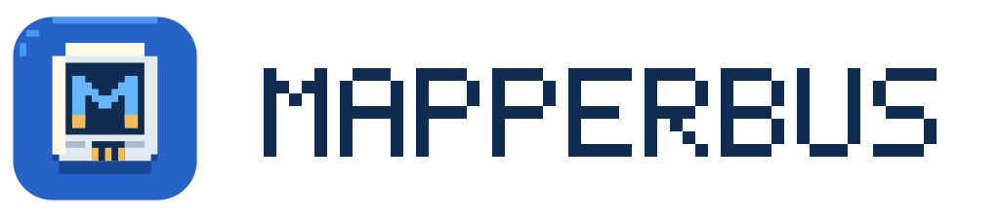
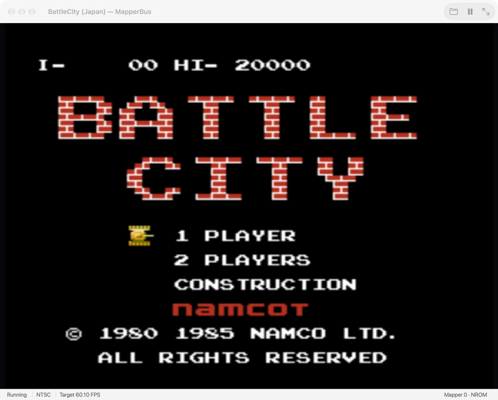

# MapperBus

<picture>
  <source media="(prefers-color-scheme: dark)" srcset="assets/branding/mapperbus-logo-light.svg">
  
</picture>

[](LICENSE)
[](https://en.cppreference.com/w/cpp/23)
[](https://mesonbuild.com/)

A NES/Famicom emulator written in C++23, with a headless emulation core,
SDL3 and NodalKit frontends, and Famicom Disk System subsystems.



## Documentation

Start at the [documentation index](docs/README.md). Documentation follows
Diátaxis, with separate paths for learning, completing tasks, looking up facts,
and understanding the design.

| I want to… | Read |
|---|---|
| Build the project for the first time | [Build and test MapperBus](docs/tutorials/build-and-test.md) |
| Play a game | [Run your first game](docs/tutorials/first-game.md) |
| Build the GUI, a headless binary, or a Linux installation | [Build and install](docs/how-to/build-and-install.md) |
| Change input, scaling, or audio | [Configure the SDL3 frontend](docs/how-to/configure-sdl3.md) |
| Look up options and defaults | [Reference](docs/reference/README.md) |
| Understand the codebase | [Architecture](docs/explanation/architecture.md) |

## Quick start

From the repository root, with a C++23 compiler and standard library, Meson,
and Ninja installed:

```sh
meson setup buildDir
meson compile -C buildDir
meson test -C buildDir --suite mapperbus --print-errorlogs
./buildDir/src/app/mapperbus-sdl3 "/path/to/game.nes"
```

The default build includes SDL3, the headless CLI, and tests. The NodalKit GUI
is optional. See [build requirements and variants](docs/how-to/build-and-install.md)
for dependencies, platform details, and reconfiguring an existing build.

## Features

- MOS 6502 CPU with unofficial opcodes, per-pixel PPU rendering, and five-channel APU.
- [Cartridge mappers](docs/reference/compatibility.md) including MMC1, MMC2, MMC3,
  MMC5, VRC6, VRC7, Namco 163, and Sunsoft 5B, with expansion audio.
- NTSC, PAL, and Dendy region detection and overrides.
- CPU and GPU xBRZ and FSR 1 upscaling, using Metal or Vulkan where available.
- BLEP resampling, selectable audio filters, dynamic rate control, dithering,
  and pseudo-stereo output.
- Keyboard and gamepad input, two-player SDL3 input, save states, battery saves,
  and shared frontend configuration.

See [compatibility and scope](docs/reference/compatibility.md) for the boundaries
of this feature list.

## License and author

[MIT](LICENSE). Aleksandr Pavlov <ckidoz@gmail.com>.
