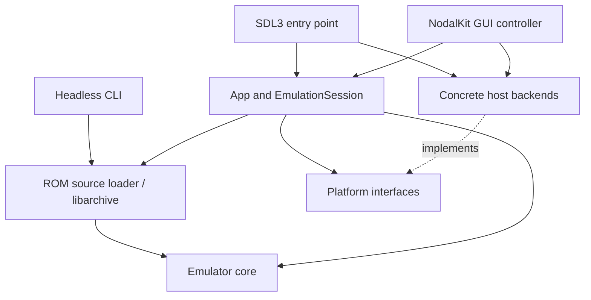

# Architecture

MapperBus separates the emulated machine from the operating system and from
the interface used to control it. This lets the same core run in a desktop
window, inside the GUI, or under tests without a display or audio device.

## The machine and the host

`core::Emulator` owns the CPU, PPU, APU, memory bus, cartridge, emulated controller,
and FDS subsystem. It advances the machine and exposes a framebuffer, audio
samples, and state serialization. None of these responsibilities requires SDL3
or NodalKit.

The platform layer describes host capabilities through video, audio, and input
interfaces. Concrete SDL3 backends implement those interfaces; null backends
make sessions usable in headless tests. CPU upscalers also live in this layer
because they transform output without changing emulation.

The core does not depend on the frontend layers or libarchive. All frontends
link the application library for ROM source loading; the CLI still advances the
core directly without initializing a session or host backends. The loader reads
ZIP and 7z members into bounded memory and passes a parsed cartridge and explicit
battery-save path to the core. Member names provide region hints and display
labels, while ROM content supplies identity. No archive entries are extracted.

## A session bridges machine and presentation

`app::EmulationSession` owns an emulator and receives video, audio, and input
backends through its constructor. It handles opening and closing cartridges,
pause and reset, frame advancement, input synchronization, audio queueing,
presentation, and save slots.

This is the common behavior that both interactive frontends need. SDL3's
`App` supplies a run loop; the NodalKit GUI integrates the session into the
toolkit's event loop. Keeping these loops outside the core prevents toolkit
events and host pacing from becoming machine dependencies.

At startup, each frontend creates its concrete backends and passes them to the
application layer. This composition makes backend choices visible at the
boundary and avoids having a session silently choose a windowing toolkit.

## A cartridge supplies variable hardware

NES cartridges use different bank-switching and sometimes audio hardware.
The cartridge loader parses a header, and the mapper registry selects a factory
by mapper number. The rest of the machine talks to a mapper interface instead
of branching on individual game titles.

Expansion audio follows the same boundary. Mappers can clock their own sound
hardware and expose an output that the APU mixes. Register routing and IRQ
polling remain coordinated through the bus and emulator timing.

CPU accesses, including dummy reads and both read-modify-write writes, pass through
the bus with their side effects. The bus advances FDS disk, timer, and watchdog
clocks before each CPU/DMA access, along with APU and expansion audio. PPU stepping
places each access between its second and third dots. Its per-pixel renderer and
scroll rules retain their existing design. OAM DMA runs after the instruction's
last write. CPU mapper
writes carry consecutive-cycle information so MMC1 can filter serial writes
without putting mapper-specific logic in the CPU. The APU schedules DMC loads
and reloads; the bus halts eligible CPU reads and arbitrates DMC/OAM gets. See
[DMA timing](../reference/dma-timing.md) for timing contracts and remaining limits.
IRQ/NMI detector outputs are recorded during bus cycles and polled at the
instruction's hardware polling points. Accepted decisions survive source
acknowledgements and I-flag changes; late NMI can redirect IRQ/BRK vectoring. See
[interrupt timing](../reference/interrupt-timing.md).

## Persistence belongs at different boundaries

Machine snapshots serialize emulation state. Battery files persist cartridge
RAM. User configuration describes host preferences such as input mappings and
audio settings. Keeping these separate means a UI preference does not become
part of cartridge hardware state.

Snapshots are taken between instructions, after any OAM DMA. CPU bus-cycle and
active-DMA bookkeeping is transient. Version 9 preserves accepted interrupts, NMI
detector state, vblank suppression and delayed frame-counter resets, alongside
the APU phase/DMC fields added in version 8. Earlier snapshots reconstruct the
missing fields; they cannot reproduce their original sampling history exactly.

The core implements snapshot and battery operations. The session assigns save
slot filenames. The application configuration layer reads and writes
`mapperbus.conf`; frontends decide which preferences they support.

## Where to explore next

- [Source tree](../reference/source-tree.md) maps these responsibilities to files.
- [Audio and video](audio-and-video.md) follows the output path and pacing.
- [Build options](../reference/build-options.md) shows how to select layers for a build.
- [Emulator](../../src/core/emulator.hpp) and
  [EmulationSession](../../src/app/emulation_session.hpp) define the main APIs.
